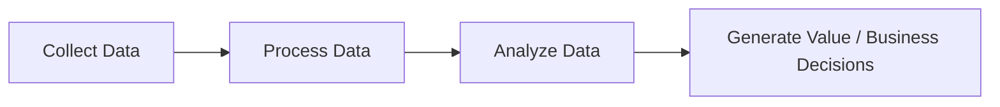
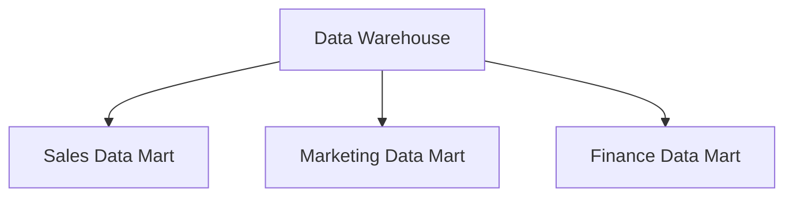
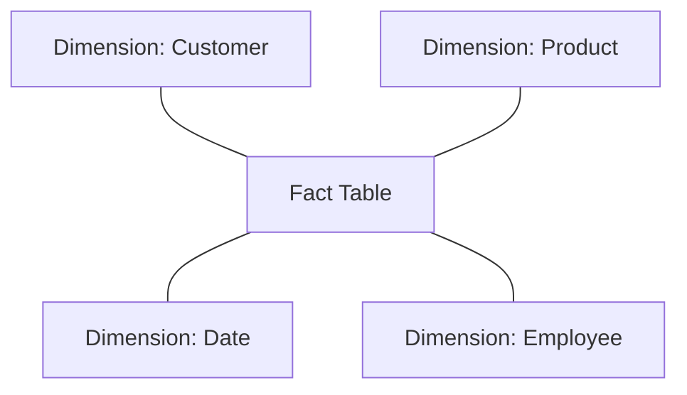
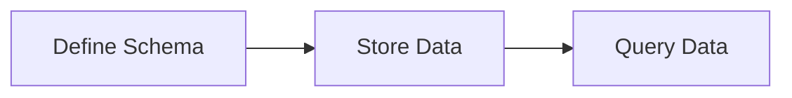
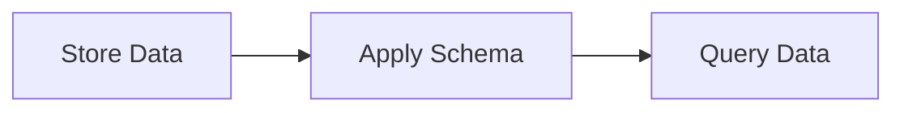
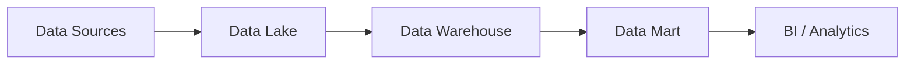
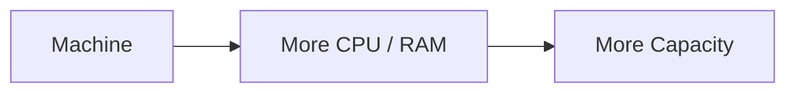
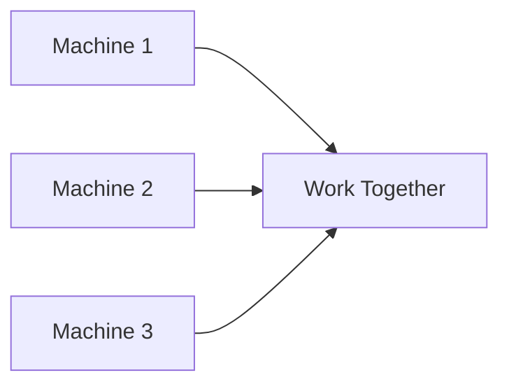
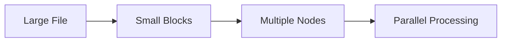

# Data Engineering — Lecture 01

## Overview

This lecture introduces the foundations of Data Engineering: where data comes from, how it is mined for patterns, how it is organized (Data Marts, Data Warehouses, Data Lakes), how transactional and analytical systems differ (OLTP vs OLAP), how analytical data is modeled (Fact and Dimension tables in a Star Schema), how schemas are applied (Schema-on-Write vs Schema-on-Read), and how systems scale to handle large volumes of data (Vertical vs Horizontal Scaling, Clusters, Hadoop/HDFS).

---

## 1. Data as the New Fuel

Data can be considered the new fuel — it can be collected, processed, analyzed, and used to generate value and support business decisions.

---

## 2. Data Sources

A **Data Engineer** collects data from many different sources:

| Category | Examples |
|---|---|
| Systems | Databases, Applications |
| Connectivity | APIs, Websites |
| Operational | Logs |
| Real-time | IoT / Sensors, Streaming Data |
| Storage | Files, Cloud Storage |
| Business | SaaS / Business Applications |
| External | Public / Open Data, Third-party Data Providers |

---

## 3. Data Mining

> **Data Mining** — Discovering useful patterns and relationships from data.

**Key points:**
- The goal is to discover useful patterns, relationships, trends, and other information.
- It works on large amounts of data.

---

## 4. Data Mart

A **Data Mart** is a smaller part of a **Data Warehouse**, dedicated to a specific department or business function.

**Examples:**
- Sales Data Mart
- Marketing Data Mart
- Finance Data Mart

### Data Warehouse vs Data Mart

| Data Warehouse | Data Mart |
|---|---|
| Data for the whole organization | Data for a specific department or business function |

---

## 5. OLTP vs OLAP

### OLTP — Online Transaction Processing
Used for daily operational transactions.

**Examples:** Orders, Payments, Accounts

**Focus:** Executing daily operations.

### OLAP — Online Analytical Processing
Used for analyzing data and supporting business decisions.

### Comparison

| OLTP | OLAP |
|---|---|
| Daily operational transactions | Data analysis |
| Orders | Business analysis |
| Payments | Decision support |
| Accounts | Large-scale analysis |

---

## 6. Fact Table & Dimension Table

### Fact Table
Contains **measurable data and metrics** related to a business process.

**Examples of measurable data:** Sales, Quantity, Discount, Profit

The Fact Table sits at the center of a **Star Schema**.

### Dimension Table
Provides the **context** used to understand and analyze the data in the Fact Table.

**Examples:** Customer, Product, Date, Employee

### Star Schema

---

## 7. Schema-on-Write vs Schema-on-Read

### Schema-on-Write
The schema is defined **before** the data is stored.

### Schema-on-Read
The data is stored first, and the schema is applied **when the data is read**.

### Comparison

| Schema-on-Write | Schema-on-Read |
|---|---|
| Schema before storing | Schema when reading |
| More structured | More flexible |
| Commonly associated with Data Warehouse | Commonly associated with Data Lake |

---

## 8. Data Warehouse vs Data Lake

### Data Warehouse
A structured and organized place for storing data for analysis. Data is cleaned, organized, and prepared for analytical use.

### Data Lake
Can store different types of data, including raw data. Provides more flexibility in how data is stored and used later.

### Comparison

| Data Warehouse | Data Lake |
|---|---|
| Structured and organized data | Can store raw data |
| Data prepared for analysis | Can store different types of data |
| More flexible | — |
| Commonly associated with Schema-on-Write | Commonly associated with Schema-on-Read |

### End-to-End Data Flow

---

## 9. Vertical Scaling vs Horizontal Scaling

### Vertical Scaling (Scale Up)
Increasing the resources of an **existing machine**.

**Examples:** More CPU, More RAM

### Horizontal Scaling (Scale Out)
**Adding more machines or nodes** to handle the workload. Important in Big Data and distributed systems.

### Comparison

| Vertical Scaling (Scale Up) | Horizontal Scaling (Scale Out) |
|---|---|
| Increase resources of one machine | Add more machines/nodes |
| More CPU / RAM | Machines work together |
| — | Important for Big Data / distributed systems |

---

## 10. Cluster

A **Cluster** is a group of machines or nodes that work together as a distributed system.

**Key points:**
- Virtual Machines can work together as nodes in a cluster.
- The machines are **not** physically merged into one machine.
- They communicate and work together to distribute the workload.

---

## 11. Hadoop and Big Data

**Hadoop** can divide large files into smaller blocks and distribute them across multiple nodes. This enables:

- Distributed storage
- Parallel processing

`HDFS` handles distributed storage of the blocks, while processing frameworks such as `MapReduce` or `Spark` process different parts of the data in parallel.

---

## Key Concepts

- Data Mining
- Data Mart
- Data Warehouse
- Data Lake
- OLTP
- OLAP
- Fact Table
- Dimension Table
- Star Schema
- Schema-on-Write
- Schema-on-Read
- Vertical Scaling
- Horizontal Scaling
- Cluster
- Hadoop
- HDFS
- Parallel Processing