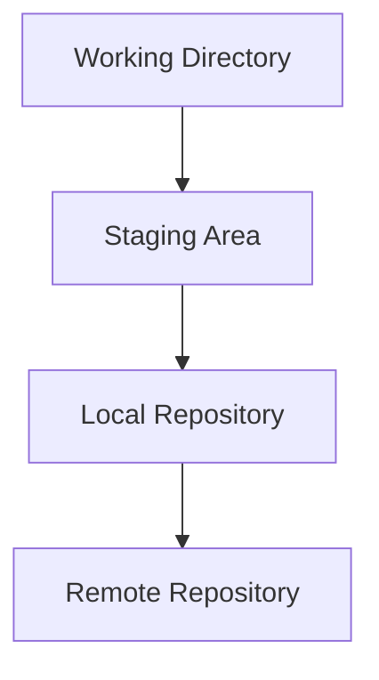
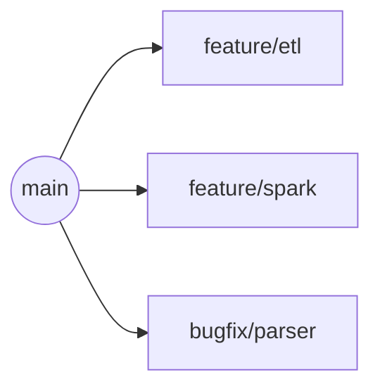
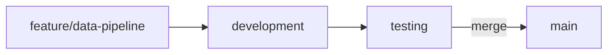
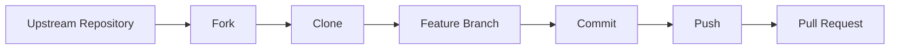
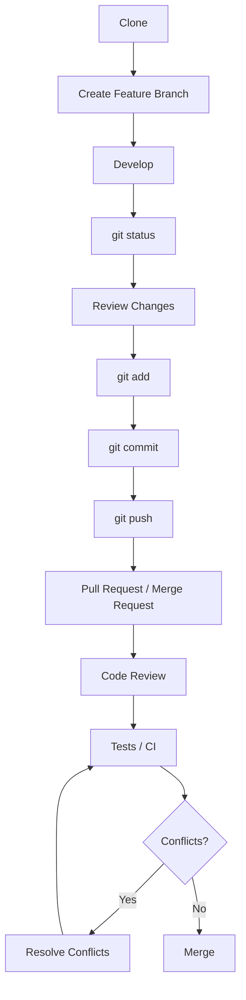
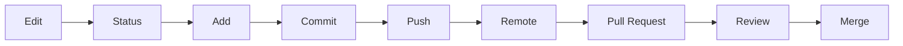

# Git Fundamentals — Lecture 03

## Overview

This is a long-term personal reference for Git — how it works, how it's used day to day, and how to talk about it in an interview. It covers version control basics, the core workflow (`status` → `add` → `commit` → `push`), branching and merging, conflicts, forks, remotes, and how all of this connects to real Data Engineering work.

> 🧠 **Mental Model (short version):** Git tracks changes locally and preserves project history. I edit files in the working tree, use `git add` to stage what I want, `git commit` to record a local version, and `git push` to publish commits to a remote. Branches isolate parallel work; merge integrates branches; conflicts require manual resolution.

---

# Git Fundamentals

## 1. 📌 What is Git?

**Simple explanation:**
Git is a tool that remembers every version of your project, so you can see what changed, undo mistakes, and work on the same code as other people without overwriting each other's work.

**Technical explanation:**
Git is a **distributed version control system (VCS)** used to track changes in files, maintain project history, work safely in parallel, and synchronize repositories between machines. "Distributed" means every clone of a repository holds the full project history, not just a working copy — so most operations (history, branching, committing) happen locally, and syncing with others is a separate, explicit step (`push`/`pull`).

**Key ideas it covers:**

| Concept | What it means |
|---|---|
| Version control | Recording snapshots of a project over time |
| Tracking changes | Knowing exactly what was added, modified, or removed |
| History | A full, searchable record of every recorded change |
| Collaboration | Multiple people working on the same project without overwriting each other |
| Local repository | The full project + history stored on your own machine |
| Remote repository | A copy of the repository hosted elsewhere (e.g., on GitHub) for sharing/syncing |

### 🎯 Interview Angle
Git questions almost always start with "what is Git," and the strongest answers mention **distributed** version control specifically — not just "it tracks changes" — because that's what separates Git from older, centralized VCS tools.

---

## 2. Git vs GitHub vs GitLab vs Bitbucket

**Key idea:** Git is the *tool*. GitHub, GitLab, and Bitbucket are *platforms* that host and add collaboration features around Git repositories.

> ⚠️ **Important:** GitHub and GitLab should not be described simply as "Git servers." GitHub is a hosted platform for Git repositories with collaboration features (pull requests, issues, CI/CD, etc.). GitLab is a hosted DevOps/Git platform with Git hosting plus a broader set of CI/CD and DevOps tooling. Both go well beyond just "serving" Git repositories.

| Tool | What It Is | Role |
|---|---|---|
| **Git** | Version control software | Tracks history locally and manages branches/commits |
| **GitHub** | Hosted Git platform | Remote repositories, collaboration, pull requests, CI/CD, issues |
| **GitLab** | Hosted DevOps/Git platform | Remote repositories, merge requests, CI/CD, issues, and DevOps features |
| **Bitbucket** | Hosted Git platform | Remote repositories and team collaboration |

### 🎯 Interview Angle
**Q: What is the difference between Git and GitHub?**
Git is the version-control software. GitHub is a hosting and collaboration platform built around Git repositories.

---

## 3. Repository

**Simple explanation:**
A repository is your project folder, plus Git's memory of every version it's ever been in.

**Technical explanation:**
A Git repository is a project directory managed by Git. It contains the project files plus Git's metadata and history, letting you track versions, branches, commits, and collaboration state.

> 🧠 **Mental Model:** Repository = Project + Git Metadata + Version History

| Type | Description |
|---|---|
| Local repository | The repository as it exists on your own machine, including full history |
| Remote repository | A copy of the repository hosted elsewhere (e.g., GitHub), used for sharing and syncing |

---

## 4. 🔄 Git Architecture / Workflow

A file doesn't become part of a commit just because it exists in the folder — Git moves changes through distinct states.



| Stage | What Lives There |
|---|---|
| Working Directory | The files you're actively editing |
| Staging Area | Changes you've chosen to include in the next commit |
| Local Repository | Recorded commits/history on your own machine |
| Remote Repository | The shared copy of the repository (e.g., on GitHub) |

**Typical flow:** Edit → `git status` → `git add` → `git commit` → `git push`

---

## 5. `git status`

**Simple explanation:**
`git status` tells you what Git currently sees has changed.

**Technical explanation:**
`git status` reports the current state of the working tree and staging area:

- Untracked files
- Modified files
- Deleted files
- Staged changes
- Current branch and tracking information

```bash
git status
```

### 👨‍💻 Data Engineer Connection
Run `git status` **frequently** — before staging, before committing, and after a pull. It's one of the safest commands available (read-only) and it's the fastest way to confirm exactly what you're about to stage or commit, which matters a lot when a pipeline script has several unrelated edits mixed together.

---

## 6. `git add`

**Simple explanation:**
`git add` picks which changes you want included in your next commit.

**Technical explanation:**
`git add` moves selected changes from the working tree into the **staging area**.

```bash
git add file.py     # stage a specific file's current changes
git add .            # stage changes under the current path (subject to ignore rules)
```

> ⚠️ **Important:** `git add` does **not** upload anything. It only moves changes locally, from the working directory into the staging area. Nothing leaves your machine at this step.

| Command | Scope |
|---|---|
| `git add file.py` | Stages only the changes in that specific file |
| `git add .` | Stages changes across the current path (respecting `.gitignore`) |

---

## 7. `git commit`

**Simple explanation:**
`git commit` saves a snapshot of your staged changes into the project's local history.

**Technical explanation:**
`git commit -m "message"` creates a recorded version/snapshot in the **local** Git history from the currently staged changes.

```bash
git commit -m "Add schema validation to ingestion job"
```

> ⚠️ **Important:** `git commit` does **not** upload code to GitHub. It only records the snapshot locally.

### add → commit → push, clearly separated

| Step | Command | Where It Happens | Purpose |
|---|---|---|---|
| 1 | `git add` | Staging Area | Choose changes for the next commit |
| 2 | `git commit` | Local Repository | Record a new version in local history |
| 3 | `git push` | Remote Repository | Publish local commits to the remote |

---

## 8. `git push`

**Simple explanation:**
`git push` sends your recorded commits from your machine to the shared remote repository.

**Technical explanation:**
`git push` sends local commits to a configured remote branch.

```bash
git push origin main
```

| Term | Meaning |
|---|---|
| Local repository | Your machine's copy, with full history |
| Remote repository | The shared, hosted copy (e.g., on GitHub) |
| Remote branch | A branch that exists on the remote repository |

**`origin`** here is the name of the remote you're pushing to (see [Remotes](#20-what-is-a-remote) below).

---

## 9. `git pull`

**Simple explanation:**
`git pull` updates your local branch with changes from the remote.

**Technical explanation:**
`git pull` normally performs a **fetch** followed by an **integration step** into the current branch — commonly a merge, though configuration can determine whether the integration uses merge or rebase.

```bash
git pull
```

> 💡 **Note:** The exact integration behavior (merge vs. rebase) depends on your Git configuration — don't assume it's always a merge.

---

## 10. `git clone`

**Simple explanation:**
`git clone` downloads a copy of an existing project, including its full history, onto your machine for the first time.

**Technical explanation:**
`git clone <URL>` creates a new local repository copy of a remote repository, including its Git history.

```bash
git clone <URL>
```

> ⚠️ **Important:** `clone` is not "starting a new project from scratch" — it's making a local copy of an **existing** repository.

### Clone vs Pull

| Aspect | `git clone` | `git pull` |
|---|---|---|
| When you use it | You don't yet have the repository locally | You already have a local clone |
| What it does | Creates a new local copy + downloads full history | Fetches remote updates and integrates them into the current branch |
| Frequency | Once, at the start | Repeatedly, to stay up to date |

---

## 11. `git fetch`

**Simple explanation:**
`git fetch` checks what's new on the remote without changing your current branch.

**Technical explanation:**
`git fetch` downloads remote updates but does **not** integrate them into your current branch.

```bash
git fetch
```

> 🧠 **Mental Model:** `fetch` = "show me what changed remotely." `pull` = "fetch + bring those changes into my current branch."

### Fetch vs Pull

| Aspect | `git fetch` | `git pull` |
|---|---|---|
| Downloads remote data | ✅ | ✅ |
| Integrates into current branch | ❌ | ✅ (fetch + integration) |
| Risk of changing your working files | None | Possible (merge/rebase happens) |

> 💡 **Note:** The exact integration step `git pull` performs depends on configuration — commonly merge, sometimes rebase.

---

# Branches

## 12. 🔀 What is a Branch?

**Simple explanation:**
A branch is a separate line of work, so you can make changes without touching the main, stable version of the code until you're ready.

**Technical explanation:**
A branch is a movable reference to a line of development. Branches let multiple lines of work evolve without immediately mixing their changes.



After review/testing, a branch can be merged back into an integration branch such as `main` or `develop`, depending on the team's workflow.

### 🎯 Interview Angle
**Q: Why use branches?**
They isolate features and fixes, reduce accidental interference between engineers' work, and support parallel development with review before anything reaches the stable branch.

---

## 13. Why Branches Matter for Data Engineers

Realistic branch names you'd actually see in a Data Engineering repo:

- `feature/airflow-dag`
- `feature/spark-etl`
- `feature/api-ingestion`
- `bugfix/schema-validation`

### 👨‍💻 Data Engineer Connection
Branches keep experimental or in-progress pipeline changes away from the production code path. A broken Spark job or a half-finished DAG lives on its own branch until it's reviewed and tested — it never directly touches the stable branch that production actually runs from.

---

## 14. Branch Commands

| Command | Purpose |
|---|---|
| `git branch` | List local branches |
| `git branch feature-x` | Create a branch |
| `git switch feature-x` | Switch to an existing branch |
| `git switch -c feature-x` | Create and switch to a new branch |
| `git merge feature-x` | Merge the specified branch into the current branch |

```bash
git branch feature/spark-etl
git switch feature/spark-etl
# ...work happens here...
git switch main
git merge feature/spark-etl
```

---

# Merge

## 15. What is `git merge`?

**Simple explanation:**
`git merge` brings the changes from one branch into the branch you're currently on.

**Technical explanation:**
`git merge feature-x` combines the history/changes of another branch into the currently checked-out branch.

```bash
git switch main
git merge feature-x
```

**A realistic (not universal) flow:**



> 💡 **Note:** This is one example flow, not a rule. Different teams use different branching strategies (e.g., trunk-based, Git Flow) — the important part is that changes go through review/testing before reaching the stable branch.

---

# Merge Conflicts

## 16. 🚨 What is a Merge Conflict?

**Simple explanation:**
A merge conflict happens when two people changed the exact same part of a file in different ways, and Git doesn't know which version to keep.

**Technical explanation:**
A merge conflict occurs when Git cannot automatically reconcile competing changes — commonly because different branches modified overlapping parts of the same file. Git pauses the merge and asks you to decide.

**Example:** Developer A changes the same lines that Developer B changed. Git cannot confidently decide which version should remain, so it marks the conflict in the file.

```text
<<<<<<< HEAD
your current branch's version of the code
=======
the incoming branch's version of the code
>>>>>>> feature-x
```

> ⚠️ **Important:** Conflict markers (`<<<<<<<`, `=======`, `>>>>>>>`) are instructions from Git showing where the competing changes are — they are **not** valid application code and must be removed before the file is usable.

---

## 17. How to Resolve a Merge Conflict

1. Run the merge or pull.
2. Git identifies and lists the conflicted files.
3. Open a conflicted file.
4. Inspect both versions (between the conflict markers).
5. Decide what the final code should be — one side, the other, or a combination.
6. Remove the conflict markers.
7. Save the file.
8. Run tests.
9. `git add` the resolved file.
10. Complete the merge/commit as required.

> ⚠️ **Important:** Testing after conflict resolution matters because removing conflict markers by hand is easy to get slightly wrong — a resolved file can still be syntactically fine but logically broken (e.g., silently dropping one side's fix). Tests catch what a visual read might miss.

---

# Fork

## 18. ☁️ What is a Fork?

**Simple explanation:**
A fork is your own copy of someone else's repository, hosted under your account, so you can make changes without needing permission on the original project.

**Technical explanation:**
A fork is a server-side (hosted) copy of another repository under your own account/namespace on a hosting platform. It's common when contributing to a project where you don't have direct write access.

> 💡 **Note:** You generally don't need write permission to fork a publicly forkable repository. Private repositories and organization policies can restrict forking.

**Typical open-source contribution flow:**



---

## 19. Fork vs Clone

> ⚠️ **Important:** Fork and clone are **not** the same thing.

| | Fork | Clone |
|---|---|---|
| Location | Remote/server-side copy | Local copy on your machine |
| Ownership | Usually under your own account/namespace | Not a separate account/namespace — just a local copy |
| Typical use | When you don't have write access to the original repository | To work locally on a repository you already have access to |

### Repository, Fork, Clone — Comparison

| Term | Location | Purpose | Example |
|---|---|---|---|
| Repository | Local or remote | Project + Git history | `data-engineering-journey` repo |
| Clone | Local copy | Bring an existing remote repo to your machine | `git clone <url>` |
| Fork | Remote copy under another account/namespace | Independent contribution/workspace on a hosted platform | Fork an open-source project on GitHub |

---

# Remotes

## 20. What is a Remote?

**Simple explanation:**
A remote is a saved link to another copy of your repository, usually one hosted online.

**Technical explanation:**
A remote is a named reference to another repository, usually a hosted one.

```bash
git remote -v
git remote add origin <URL>
git push -u origin main
```

> ⚠️ **Important:** `origin` is just a conventional name for a remote — it is **not** the GitHub server itself. You could name a remote anything; `origin` is simply the widely used default.

---

# Git Platforms

| Platform | Role |
|---|---|
| **GitHub** | Hosting and collaboration around Git repositories (PRs, issues, CI/CD) |
| **GitLab** | Git hosting plus broader DevOps/CI/CD capabilities |
| **Bitbucket** | Git hosting and team collaboration, commonly used with Atlassian tooling |
| **Self-hosted Git** | Organizations host and manage their own Git infrastructure |

---

# Git + Data Engineering

## 21. 📊 Why Git Matters to a Data Engineer

Practical, everyday uses:

- Version-controlling 🐍 Python ETL/ELT scripts
- Version-controlling SQL transformations
- Maintaining Airflow DAGs
- Tracking ⚡ Spark jobs and their configuration
- Data quality check scripts
- Dockerfiles
- Documentation
- CI/CD pipeline definitions
- Code review through Pull Requests/Merge Requests
- Rolling back to a known-good commit when a deployment breaks something

> ⚠️ **Important:** Git is primarily for versioning **source code, configuration, and documentation** — it is **not** a replacement for a 🗄️ Data Lake, Data Warehouse, Object Storage, or HDFS. Do not store large production datasets directly in Git.

### 🎯 Interview Angle
**Q: Should we store production datasets in Git?**
No — Git is built for versioning source code, configuration, and documentation, not large binary or tabular datasets. Production data belongs in a Data Lake, Data Warehouse, or object storage; Git tracks the code and configuration that *produces* and *processes* that data.

---

# Real Team Workflow

## 22. Practical Team Workflow



| Step | What Happens |
|---|---|
| Clone | Get the repository locally (once) |
| Create feature branch | Start isolated work without touching the stable branch |
| Develop | Make the actual code/pipeline changes |
| `git status` | Confirm exactly what changed |
| Review changes | Read your own diff before staging it |
| `git add` | Stage the intended changes |
| `git commit` | Record a local snapshot with a meaningful message |
| `git push` | Publish the branch to the remote |
| Pull Request / Merge Request | Propose the change for review |
| Code Review | A teammate reviews the diff |
| Tests / CI | Automated checks run against the change |
| Resolve conflicts if needed | Manually reconcile overlapping changes |
| Merge | The change joins the stable branch, following the team's branching policy |

---

# Command Reference

| Command | Purpose | Example | Data Engineering Relevance |
|---|---|---|---|
| `git status` | Show current state: modified/untracked/staged files, branch info | `git status` | Confirm exactly what a pipeline script change touches before staging |
| `git add` | Stage a specific file's changes | `git add etl.py` | Stage only the ETL script you actually finished editing |
| `git add .` | Stage changes under the current path | `git add .` | Quickly stage a batch of related config/script changes |
| `git commit` | Record staged changes as a local snapshot | `git commit -m "Fix null handling in ingestion"` | Create a reviewable, revertible checkpoint in pipeline history |
| `git push` | Send local commits to a remote branch | `git push origin main` | Publish a finished pipeline change for the team/CI to see |
| `git pull` | Fetch + integrate remote changes into current branch | `git pull` | Sync your branch before starting new pipeline work |
| `git fetch` | Download remote updates without integrating them | `git fetch` | Check what changed on `main` before deciding to merge |
| `git clone` | Create a local copy of a remote repository | `git clone <url>` | Get the team's Data Engineering repo for the first time |
| `git branch` | List/create local branches | `git branch feature/spark-etl` | Start isolated work on a new pipeline feature |
| `git switch` | Switch between branches | `git switch feature/spark-etl` | Move between in-progress pipeline features |
| `git merge` | Merge another branch into the current one | `git merge feature/spark-etl` | Bring a finished, reviewed feature into `main` |
| `git remote` | Manage remote references | `git remote add origin <url>` | Point your local repo at the team's GitHub repository |
| `git remote -v` | List configured remotes with URLs | `git remote -v` | Confirm which remote you're about to push to |
| `git diff` | Show unstaged/uncommitted changes | `git diff` | Review exactly what changed in a script before staging it |
| `git log` | Show commit history | `git log --oneline` | Trace when a bug was introduced into a pipeline |

---

# Important Additional Commands

| Command | Simple Explanation |
|---|---|
| `git diff` | Shows the exact line-by-line changes that aren't staged yet |
| `git log` | Shows the commit history |
| `git log --oneline` | Shows the commit history in a compact, one-line-per-commit form |
| `git show` | Shows the details/diff of a specific commit |
| `git restore` | Discards changes in the working directory, reverting a file back to its last committed state |
| `git restore --staged` | Unstages a file without discarding its changes (moves it back to the working directory) |

```bash
git diff
git log --oneline
git show <commit-hash>
git restore file.py            # discard unstaged changes to file.py
git restore --staged file.py   # unstage file.py, keep the edits
```

---

# 🧠 Git Mental Model



**Where branches and conflicts fit:** Branches sit *around* this whole flow — each line of work (Edit → ... → Push) typically happens on its own branch, kept separate from `main`. Conflicts can appear at the **Merge** step, whenever two branches changed overlapping parts of the same file; resolving them is a manual detour before the merge can complete.

---

# 🎯 Git Interview Questions

### 1. What is Git?
Git is a distributed version control system used to track changes, maintain history, create branches, and collaborate safely on projects.

### 2. What is a repository?
A repository is a project managed by Git. It contains the project files plus Git metadata and history.

### 3. Git vs GitHub?

**Short Answer:**
Git is the version-control software; GitHub is a hosting and collaboration platform built around Git repositories.

**Strong Answer:**
Git runs locally and manages history, branches, and commits on your machine. GitHub hosts remote copies of Git repositories and adds collaboration features on top — pull requests, issue tracking, CI/CD, code review — none of which are part of Git itself.

**Possible Follow-up:** "Is GitHub the only way to use Git?"
**Answer:** No — Git works entirely without GitHub. You can use Git locally, or host repositories on GitLab, Bitbucket, or a self-hosted server.

### 4. What does `git add` do?

**Short Answer:**
`git add` stages changes for the next commit.

**Strong Answer:**
`git add` moves selected changes from the working tree into the staging area so I can choose exactly what should be included in the next commit.

**Possible Follow-up:** "Does `git add` upload the file to GitHub?"
**Answer:** No. `git add` only stages the change locally. The commit records it locally, and `git push` publishes the commit to the remote.

### 5. What does `git commit` do?

**Short Answer:**
`git commit` records the staged changes as a new snapshot in local history.

**Strong Answer:**
`git commit -m "message"` takes whatever is currently in the staging area and records it as a new commit in the local repository's history, with a message describing the change.

**Possible Follow-up:** "Does `git commit` send anything to the remote?"
**Answer:** No — commit is entirely local. Nothing reaches the remote until `git push`.

### 6. What does `git push` do?
It transfers local commits to a configured remote repository/branch.

### 7. What does `git pull` do?
It fetches changes from a remote and integrates them into the current branch, commonly using merge, depending on configuration.

### 8. `git clone` vs `git pull`?

**Short Answer:**
Clone gets a repository for the first time; pull updates a repository you already have.

**Strong Answer:**
`git clone` creates a brand-new local copy of a remote repository, including its full history — you use it once, when you don't yet have the repo locally. `git pull` fetches and integrates new changes into a local clone you already have — you use it repeatedly to stay up to date.

### 9. `git fetch` vs `git pull`?

**Short Answer:**
Fetch downloads remote changes without touching your branch; pull downloads and integrates them.

**Strong Answer:**
`git fetch` downloads what's new on the remote but leaves your current branch untouched, so I can inspect incoming changes first. `git pull` does that fetch and then integrates the changes into my current branch — commonly via merge, though that depends on configuration.

### 10. What is a branch?
A branch is a separate line of development that lets engineers work on changes without immediately affecting another branch.

### 11. Why do we use branches?
They isolate features and fixes, reduce accidental interference, and support parallel team development and review.

### 12. What is `git merge`?
Merge integrates changes from one branch into the branch currently checked out.

### 13. What is a merge conflict?
It happens when Git cannot automatically reconcile competing changes, often because branches changed overlapping parts of a file. I resolve it manually, test the result, stage the resolved files, and complete the merge.

### 14. How do you resolve a merge conflict?

**Short Answer:**
I open the conflicted file, decide which changes to keep, remove the conflict markers, test, then stage and complete the merge.

**Strong Answer:**
After a merge reports conflicts, I open each conflicted file and look at the sections marked with `<<<<<<<`, `=======`, and `>>>>>>>`. I decide whether to keep one side, the other, or a combination, remove the markers, save the file, and run tests to make sure the resolution is actually correct — not just conflict-marker-free. Then I `git add` the resolved files and complete the commit.

**Possible Follow-up:** "Why run tests after resolving a conflict?"
**Answer:** Because a manually resolved file can look syntactically fine but silently drop one side's logic — tests catch that in a way a visual read might miss.

### 15. What is a fork?
A fork is a hosted copy of a repository under another account or namespace, commonly used when I don't have direct write access to the original repository.

### 16. Fork vs clone?

**Short Answer:**
Fork is a remote copy under your account; clone is a local copy on your machine.

**Strong Answer:**
A fork creates an independent, server-side copy of a repository under my own account or namespace — typically so I can contribute to a project I don't have write access to. A clone brings any repository (including my own fork) down to my local machine so I can actually work on it.

### 17. What is `origin`?
`origin` is just the conventional name for a remote — it's not the GitHub server itself. It's simply the default label Git uses for the remote you cloned from or configured.

### 18. Why does a Data Engineer need Git?

**Short Answer:**
It gives version control and safe collaboration for pipeline code.

**Strong Answer:**
It gives me version control and collaboration for ETL code, SQL, Airflow DAGs, Spark jobs, configurations, and documentation — while enabling code review before changes reach production and a reliable way to roll back if a deployment breaks something.

### 19. Should we store production datasets in Git?
No — Git is built for versioning source code, configuration, and documentation, not large production datasets. That data belongs in a Data Lake, Data Warehouse, or object storage; Git tracks the code that produces and processes it, not the data itself.

### 20. How would you use Git in a Data Engineering project?
I'd version-control the ETL/ELT scripts, SQL transformations, Airflow DAGs, Spark job configs, and data-quality checks; work on changes in feature branches; open Pull Requests for review and CI; and rely on commit history to roll back if something breaks in a deployment.

---

## 🧠 Final Mental Model

Git tracks changes locally and preserves project history. I edit files in the working tree, use `git add` to stage what I want, `git commit` to record a local version, and `git push` to publish commits to a remote. Branches isolate parallel work; merge integrates branches; conflicts require manual resolution. Clone creates a local copy of an existing remote repository, pull updates an existing clone, and fork creates a hosted copy under another account/namespace.

---

## ✅ Revision Checklist

- [ ] Explain Git vs GitHub/GitLab
- [ ] Explain repository
- [ ] Explain working tree, staging area, local repo, remote repo
- [ ] Explain `git status`
- [ ] Explain `git add`
- [ ] Explain `git commit`
- [ ] Explain `git push`
- [ ] Explain `git pull`
- [ ] Explain `git clone`
- [ ] Explain fetch vs pull
- [ ] Explain branches
- [ ] Explain merge
- [ ] Explain merge conflicts and how to resolve them
- [ ] Explain fork
- [ ] Explain fork vs clone
- [ ] Explain remotes and `origin`
- [ ] Connect Git workflows to Data Engineering projects
- [ ] Answer the interview questions naturally

---

## 🎯 Interview Readiness Checklist

- [ ] I can explain Git in 30 seconds.
- [ ] I can explain Git vs GitHub.
- [ ] I can explain the working tree and staging area.
- [ ] I can explain add → commit → push.
- [ ] I can explain clone vs pull.
- [ ] I can explain fetch vs pull.
- [ ] I can explain branches.
- [ ] I can explain merge.
- [ ] I can resolve a merge conflict.
- [ ] I can explain fork vs clone.
- [ ] I can explain origin.
- [ ] I can explain how Git is used in Data Engineering.