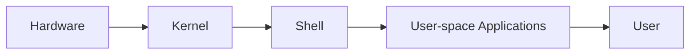
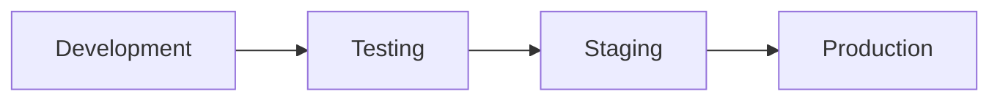
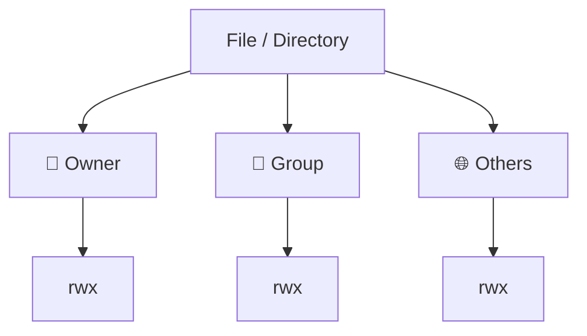
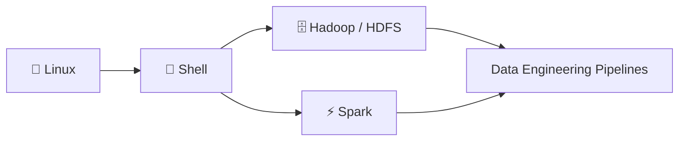

# Linux & Git Fundamentals — Lecture 02

## Overview

This lecture covers Linux fundamentals for Data Engineering work: system architecture, distributions, core commands, environments (Development → Testing → Staging → Production), file permissions, ownership, users/groups/sudo, process management, `curl` vs `wget`, and shell scripting as it connects to HDFS and Spark.

> 💡 **Note:** The lecture material discussed here covers Linux fundamentals only — no Git topics were included in the source content, so none are added here to avoid presenting untaught material as covered.

---

## 1. 🐧 Linux System Architecture

**Simplified flow:**



| Layer | Description |
|---|---|
| Hardware | CPU, RAM, storage, network devices |
| Kernel | The core of Linux; manages processes, memory, filesystems, devices, and networking |
| Shell | Command-line interface used to interact with the OS (e.g., Bash, Zsh) |
| User space | Applications and tools such as Python, Git, Spark, and Hadoop |

### 🎯 Interview Q&A

**Q: Why is Linux important for a Data Engineer?**
**Answer:** Linux is widely used for servers and data platforms. I use it for file management, permissions, process management, troubleshooting, automation, and running technologies such as Hadoop, Spark, and Airflow.

---

## 2. Linux Distributions & WSL

**Linux distributions (distros)** are complete operating-system environments built around the Linux kernel, with utilities, libraries, package managers, and defaults.

> ⚠️ **Important:** The Linux **kernel** and a Linux **distribution** are not the same thing. The kernel is the core; a distribution packages the kernel with everything needed to make a usable OS.

| Distribution Family | Examples | Typical Package Manager |
|---|---|---|
| Debian-based | Debian, Ubuntu | APT |
| Red Hat-based | RHEL, Fedora, Rocky Linux | DNF |

**WSL (Windows Subsystem for Linux)** lets Windows users run Linux environments such as Ubuntu without replacing Windows.

### 🎯 Interview Q&A

**Q: What is the difference between a Linux distribution and the Linux kernel?**
**Answer:** The kernel is the core that manages hardware and system resources. A distribution packages the kernel with utilities, libraries, package management, and other software to provide a complete operating-system environment.

---

## 3. Core Linux Commands

| Command | Meaning | Why It Matters |
|---|---|---|
| `pwd` | Print Working Directory | Know where you are |
| `ls` | List directory contents | Inspect files/directories |
| `ls -a` | Include hidden entries | Inspect config files such as `.bashrc` |
| `ls -l` | Long listing | See permissions, owner, group, size, time |
| `ls -ltr` | Long listing + time sort + reverse | Useful for finding older/newer files and logs |
| `cd` | Change directory | Navigate |
| `cd ..` | Parent directory | Move one level up |
| `cd ~` | Home directory | Return to user home |
| `mkdir` | Make directory | Create folders |
| `mkdir -p` | Create parent directories as needed | Create directory trees in one command |
| `history` | Command history | Review previous commands |
| `man` | Manual | Detailed command documentation |
| `command --help` | Quick help | Fast options/usage reference |

```bash
# Example: create a nested directory tree in one command
mkdir -p data/raw/2026

# Example: list files, newest changes last
ls -ltr
```

> ⚠️ **Important:** `ls -t` sorts by **modification time** — it does not reliably reflect creation time.

---

## 4. Development → Testing → Staging → Production



| Environment | Purpose | Data Engineering Example |
|---|---|---|
| Development | Build and change features | Develop a new ETL transformation |
| Testing | Verify behavior and detect bugs | Run automated tests against pipeline logic |
| Staging | Final validation in a production-like environment | Validate an Airflow/Spark deployment before release |
| Production | Real system used by users/business processes | Run live ETL/ELT pipelines on real data |

> 💡 **Note:** Mental model — Development = build → Testing = verify → Staging = rehearse → Production = serve.

---

## 5. 🔐 Linux Permissions: `rwx`

Permissions are evaluated for three classes: **Owner (user)**, **Group**, and **Others**.



| Permission | Numeric Value | File Meaning | Directory Meaning |
|---|---|---|---|
| `r` | 4 | Read contents | List directory entries |
| `w` | 2 | Modify contents | Create/delete/rename entries when combined with appropriate access |
| `x` | 1 | Execute program/script | Traverse/access entries inside directory |

> ⚠️ **Important:** Execute permission (`x`) means something different for files versus directories — for a file it allows execution, for a directory it allows traversal/access into it.

---

## 6. `chmod` — Numeric Permissions

**`chmod`** changes permissions. Numeric mode uses `4 = read`, `2 = write`, `1 = execute`.

| Number | Combination | Symbolic Form |
|---|---|---|
| 7 | 4+2+1 | `rwx` |
| 6 | 4+2 | `rw-` |
| 5 | 4+1 | `r-x` |
| 4 | 4 | `r--` |
| 3 | 2+1 | `-wx` |
| 2 | 2 | `-w-` |
| 1 | 1 | `--x` |
| 0 | 0 | `---` |

```bash
# Example
chmod 754 test.py
```

This means:

| Class | Permission |
|---|---|
| Owner | `rwx` |
| Group | `r-x` |
| Others | `r--` |

> 💡 **Note:** For a Python script, execute permission alone does not define how it runs — an executable script commonly needs a valid shebang (e.g., `#!/usr/bin/env python3`) and an appropriate environment.

### 🎯 Interview Q&A

**Q: Explain `chmod 754`.**
**Answer:** The owner has `rwx`, the group has `r-x`, and others have `r--`. The values come from read=4, write=2, and execute=1.

---

## 7. Ownership: `chown`

`chmod` answers **"what can they do?"**; `chown` answers **"who owns it?"**.

```bash
sudo chown amin:data-engineers data.csv
```

This changes the owner to `amin` and the group to `data-engineers`.

### 🎯 Interview Q&A

**Q: What is the difference between `chmod` and `chown`?**
**Answer:** `chmod` changes permissions; `chown` changes ownership. `chmod` answers what the owner/group/others can do, while `chown` determines who owns the file and which group is associated with it.

---

## 8. 👤 Users, Groups, UID/GID, and `sudo`

A user has a **UID**; a group has a **GID**. The ID identifies the account/group internally; permissions determine access.

> ⚠️ **Important:** There is no separate "sudo user" type. A normal user may be **authorized** to run `sudo`, which temporarily executes a command with elevated privileges according to sudo policy.

### Root vs Normal User vs Sudo-Authorized User

| Concept | What It Is | Data Engineer Example |
|---|---|---|
| Normal user | Limited account | Run Python, Git, inspect own files |
| Sudo-authorized user | Normal user allowed controlled privilege elevation | Install a package or restart an allowed service |
| `root` | Superuser with very broad system privileges | System administration, protected configuration |

### Users vs Groups vs Others

| Concept | Description |
|---|---|
| User (Owner) | The individual account that owns a file/process |
| Group | A collection of users sharing access, identified by a GID |
| Others | Everyone who is neither the owner nor a member of the owning group |

**Group example:** the `data-engineers` group shares access to a project directory.

> 💡 **Note:** Least privilege is an important security principle — give each user/service only the access required to perform its job.

### 🎯 Interview Q&A

**Q: What is `sudo`?**
**Answer:** `sudo` lets an authorized normal user execute a specific command with elevated privileges according to the system's sudo policy. It is not a separate type of user.

**Q: What is the difference between root and a sudo-enabled user?**
**Answer:** Root is the superuser. A sudo-enabled user is still a normal user but can elevate privileges for authorized commands. Least privilege is preferred over unrestricted root access.

**Q: Why use groups in Linux?**
**Answer:** Groups let administrators manage shared access for multiple users efficiently. For example, a `data-engineers` group can receive access to a shared project directory instead of configuring every user separately.

---

## 9. `usermod`

`usermod` modifies user-account properties.

```bash
sudo usermod -aG data-engineers amin
```

> ⚠️ **Important:** `-aG` = append the user to supplementary groups. Without `-a`, using `-G` can **replace** the existing supplementary group list.

| Option | Meaning |
|---|---|
| `-d` | Set home directory |
| `-m` | Move home directory contents |
| `-s` | Set login shell |
| `-l` | Set login name |
| `-L` | Lock account |
| `-U` | Unlock account |

### 🎯 Interview Q&A

**Q: How would you add a user to a group without removing their existing groups?**
**Answer:** Use `usermod -aG <group> <user>` — the `-a` (append) flag is essential, since `-G` alone can overwrite the existing supplementary group list.

---

## 10. ⚙️ Processes & PIDs

A **process** is a running instance of a program. Linux identifies processes using **PIDs (Process IDs)**.

| Command | Use |
|---|---|
| `ps` | Inspect processes associated with the current session |
| `ps aux` | Broad view of processes |
| `pgrep python` | Find PIDs matching `python` |
| `kill PID` | Send `SIGTERM` by default; request graceful termination |
| `kill -9 PID` | Send `SIGKILL`; force termination |
| `Ctrl+C` | Usually sends `SIGINT` to the foreground process |

> ⚠️ **Important:** Prefer graceful termination (`kill PID`) before `SIGKILL` when possible, because applications may need to clean up resources or flush state.

### 🎯 Interview Q&A

**Q: How would you find a process PID?**
**Answer:** I can use `ps`/`ps aux` to inspect processes, or `pgrep` with a process name — for example, `pgrep python`.

**Q: What does `kill` do?**
**Answer:** `kill` sends a signal to a process. By default it sends `SIGTERM`, requesting graceful termination. `kill -9` sends `SIGKILL` and forces termination.

---

## 11. 🌐 `curl` vs `wget`

| Tool | Typical Use | Data Engineering Example |
|---|---|---|
| `curl` | HTTP/API requests and data transfer | Call a REST API and inspect JSON |
| `wget` | File downloading | Download a CSV/Parquet/archive from a URL |

> 💡 **Note:** There is overlap — `curl` can download files too. The distinction above is about typical usage, not a strict rule.

### 🎯 Interview Q&A

**Q: `curl` vs `wget`?**
**Answer:** `curl` is commonly used for HTTP/API interaction and data transfer; `wget` is commonly used for downloading files. There is overlap between the two.

---

## 12. 📜 Shell Scripting

A **shell script** is a file containing a sequence of shell commands that can be executed automatically.

**Data Engineering uses:** file management, downloading data, environment preparation, HDFS commands, launching Python/Spark jobs, checks, and operational automation.

> ⚠️ **Important:** Shell scripts are excellent for operational automation, but larger workflows may need orchestration tools such as **Airflow**. Shell scripting is not a replacement for orchestration tools in complex production workflows.

### 🎯 Interview Q&A

**Q: What is a shell script and how would you use it as a Data Engineer?**
**Answer:** It is a file containing shell commands for automation. I can use it to prepare directories, download data, interact with HDFS, inspect files/logs, and trigger Python or Spark jobs.

---

## 13. 🗄️ Shell + HDFS: Practical Connection

Shell scripting can automate HDFS operations.

**Conceptual flow:** create HDFS directory → upload data → verify → trigger processing.


```bash
hdfs dfs -mkdir -p /data/raw
hdfs dfs -put data.csv /data/raw/
hdfs dfs -ls /data/raw/
spark-submit etl_job.py
```

> ⚠️ **Important:** Shell = automation mechanism; HDFS = distributed storage system. They serve different roles in a pipeline.

### Linux → Shell → Hadoop/Spark/Data Engineering Relationship



---

## 14. Important Linux Concepts to Add Next

> 💡 **Note:** These topics were flagged in the lecture as areas to study next — they are listed here as a to-do, not as content covered in this lecture.

- File operations: `cp`, `mv`, `rm`, `touch`
- Text processing: `grep`, `awk`, `sed`, `cut`, `sort`, `uniq`, `wc`
- Inspection: `cat`, `less`, `head`, `tail`, `tail -f`
- Searching: `find`
- Pipes: `|`
- Redirection: `>` and `>>`
- Exit codes: `echo $?`
- Environment variables
- SSH / SCP / SFTP
- Services and logs
- `cron` / scheduling
- Basic networking: ports, `ss`, DNS

---

## 15. Interview Mindset

Do not only memorize command syntax. For every command, know:

- What problem does it solve?
- What changes does it make?
- What permissions does it require?
- What could go wrong?
- How would I use it in a real data pipeline?

A strong Data Engineer answer connects Linux fundamentals to real workloads: logs → troubleshooting; permissions → secure data access; shell → automation; HDFS → distributed storage; Spark → processing; Airflow → orchestration.

---

## Key Takeaways

- Linux architecture flows Hardware → Kernel → Shell → User-space Applications → User.
- A **distribution** ≠ the **kernel**; a distro packages the kernel with a full OS environment.
- Permissions apply to three classes — Owner, Group, Others — using `r=4`, `w=2`, `x=1`.
- `chmod` changes permissions; `chown` changes ownership.
- There is no distinct "sudo user" — sudo is an authorization, not an account type. `root` is the superuser.
- Groups let admins manage shared access efficiently (e.g., `data-engineers`).
- `kill PID` requests graceful termination (`SIGTERM`); `kill -9 PID` forces termination (`SIGKILL`).
- `curl` is typically for HTTP/API work; `wget` is typically for downloading files — with overlap.
- Shell scripts automate operational tasks, including HDFS commands and triggering Spark jobs, but are not a substitute for orchestration tools like Airflow in complex production workflows.
- Least privilege is a core security principle to apply to users and services.

---

## Quick Command Reference

| Category | Command | Purpose |
|---|---|---|
| Navigation | `pwd` | Show current directory |
| Navigation | `ls -l` / `ls -a` / `ls -ltr` | List contents with detail/hidden/time-sorted |
| Navigation | `cd`, `cd ..`, `cd ~` | Change directory / go up / go home |
| Directories | `mkdir -p` | Create nested directories |
| Help | `man`, `command --help` | Documentation and quick usage |
| Permissions | `chmod 754 file` | Set owner/group/others permissions |
| Ownership | `chown user:group file` | Change owner and group |
| Users/Groups | `usermod -aG group user` | Add user to a group (append) |
| Processes | `ps aux`, `pgrep name` | Inspect / find processes |
| Processes | `kill PID`, `kill -9 PID` | Graceful / forced termination |
| Networking | `curl <url>` | HTTP/API request |
| Networking | `wget <url>` | Download a file |
| HDFS | `hdfs dfs -mkdir -p /path` | Create HDFS directory |
| HDFS | `hdfs dfs -put file /path/` | Upload data to HDFS |
| HDFS | `hdfs dfs -ls /path/` | List HDFS directory |
| Spark | `spark-submit job.py` | Trigger a Spark job |

---

## Interview Questions & Strong Answers

**Q: Why is Linux important for a Data Engineer?**
Linux is widely used for servers and data platforms. I use it for file management, permissions, processes, troubleshooting, automation, and running technologies such as Hadoop, Spark, and Airflow.

**Q: What is the difference between a Linux distribution and the Linux kernel?**
The kernel is the core that manages hardware and system resources. A distribution packages the kernel with utilities, libraries, package management, and other software to provide a complete operating-system environment.

**Q: What is the difference between `chmod` and `chown`?**
`chmod` changes permissions; `chown` changes ownership. `chmod` answers what the owner/group/others can do, while `chown` determines who owns the file and which group is associated with it.

**Q: Explain `chmod 754`.**
The owner has `rwx`, the group has `r-x`, and others have `r--`. The values come from read=4, write=2, and execute=1.

**Q: What is `sudo`?**
`sudo` lets an authorized normal user execute a specific command with elevated privileges according to the system's sudo policy. It is not a separate type of user.

**Q: What is the difference between root and a sudo-enabled user?**
Root is the superuser. A sudo-enabled user is still a normal user but can elevate privileges for authorized commands. Least privilege is preferred over unrestricted root access.

**Q: How would you find a process PID?**
I can use `ps`/`ps aux` to inspect processes or `pgrep` with a process name, for example `pgrep python`.

**Q: What does `kill` do?**
`kill` sends a signal to a process. By default it sends `SIGTERM`, requesting graceful termination. `kill -9` sends `SIGKILL` and forces termination.

**Q: `curl` vs `wget`?**
`curl` is commonly used for HTTP/API interaction and data transfer; `wget` is commonly used for downloading files. There is overlap.

**Q: What is a shell script and how would you use it as a Data Engineer?**
It is a file containing shell commands for automation. I can use it to prepare directories, download data, interact with HDFS, inspect files/logs, and trigger Python or Spark jobs.

**Q: Why use groups in Linux?**
Groups let administrators manage shared access for multiple users efficiently. For example, a `data-engineers` group can receive access to a shared project directory instead of configuring every user separately.

---

## Data Engineer Practical Connections

| Linux Concept | Real Workload Connection |
|---|---|
| Logs | Troubleshooting pipeline failures |
| Permissions | Securing data access to sensitive files/directories |
| Shell scripting | Automating repetitive operational tasks |
| HDFS | Distributed storage for large datasets |
| Spark | Distributed data processing |
| Airflow | Orchestrating multi-step production workflows |

---

## Personal Revision Checklist

- [ ] Explain Linux architecture in my own words
- [ ] Explain distro vs kernel
- [ ] Use `pwd`, `ls`, `cd`, `mkdir` confidently
- [ ] Read `ls -l` permission output
- [ ] Convert `rwx` to numeric `chmod` values
- [ ] Explain owner/group/others
- [ ] Explain UID/GID
- [ ] Explain root vs sudo-authorized user
- [ ] Use `chmod` and `chown` safely
- [ ] Add a user to a group with `usermod -aG`
- [ ] Find and stop a process using PID
- [ ] Explain `SIGTERM` vs `SIGKILL`
- [ ] Explain `curl` vs `wget`
- [ ] Explain shell scripting
- [ ] Connect shell scripts to HDFS/Spark workflows
- [ ] Answer the interview questions above without memorizing a script