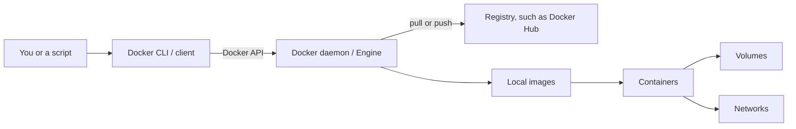

# 01 — Docker Fundamentals

## What Docker does

Docker is a platform and toolset for building, distributing, and running applications in containers. A container packages an application and its user-space dependencies in an image. It helps teams run a consistent software environment across development, CI, and deployment, but does not eliminate differences in host hardware, kernel, configuration, or external services.

Development environments drift when operating systems, library versions, environment variables, paths, and installed tools differ. Documenting and packaging dependencies reduces this drift and makes setup repeatable.

## Bare metal, virtual machines, and containers

- **Bare metal:** applications run directly on an operating system installed on physical hardware.
- **Virtual machine:** a hypervisor presents virtual hardware; each VM runs a guest OS and its own kernel.
- **Container:** isolated processes use the host's relevant kernel, with filesystem, process, and network isolation configured by the container runtime. Linux containers need a Linux kernel. Windows Docker Desktop commonly runs Linux containers inside a lightweight Linux environment through WSL 2 or Hyper-V; Windows containers use Windows kernel facilities and require compatible Windows hosts.

Containers generally start quickly and use fewer resources than full VMs, while VMs provide a separate guest kernel and stronger OS boundary in many designs. Neither replaces the other in every situation.

## The pieces

Hardware runs the host OS. Docker Engine provides the API and runtime used to manage images, containers, networks, and volumes. An **image** is a read-only, layered template; a **container** is an instance with a writable runtime layer. A **registry** stores and distributes images. Docker Desktop bundles developer tooling and a Docker Engine environment for desktop operating systems.

Docker's client-server architecture has a CLI/client, a daemon (`dockerd`) that manages Docker objects, and registries such as Docker Hub. The client sends API requests to the daemon. A pull fetches image layers from a registry; a run creates and starts a container from an image.



Docker Hub is one public registry service. A registry is the general service that stores and distributes images; teams may instead use a private registry. Docker Desktop packages the client and developer-facing controls with a managed Engine environment. For Linux containers on Windows, the container workload uses a Linux kernel provided through WSL 2 or, depending on configuration, Hyper-V. A Windows host kernel does not directly run Linux containers as Windows-kernel processes.

## Benefits and limits

Containers improve repeatability, isolation, portability across compatible hosts, and resource efficiency. They support fast local integration environments, CI jobs, and application packaging. Limits include kernel coupling, persistent-data management, networking complexity, resource contention, image supply-chain risks, and differences across CPU architecture and host configuration. Containers are not automatically secure sandboxes and do not replace backups or operational controls.

## Docker in Data Engineering

Use containers to develop and test databases, brokers, orchestration tools, and ingestion applications locally; package batch jobs; and create consistent CI environments. Production data systems still require deliberate storage, secrets, monitoring, resource sizing, recovery, and deployment architecture. Compose is useful for local multi-container environments; it is not a universal replacement for an orchestrator such as Kubernetes.

**When to use it:** a Data Engineer can define a repeatable local stack (for example, a Python loader and MySQL) without installing each service directly on the host. The database volume, network, and runtime configuration still need deliberate choices.

**Common mistake:** assuming an image makes every host identical. The host kernel, CPU architecture, mounted files, ports, and external dependencies can still differ.

**Interview check:** What does Docker Desktop provide on Windows, and which kernel does a Linux container use? Explain the client → daemon → registry path when pulling an image.

## First checks

```bash
docker version          # client and server sections should both be present
docker info              # engine configuration and runtime details
docker compose version
```

If the server section is unavailable, the daemon may not be running or the current Docker context may point to an unavailable engine. Docker Desktop must be started on Windows before Linux container commands can run.

## References

[Docker overview](https://docs.docker.com/get-started/docker-overview/) · [Docker Desktop WSL 2 backend](https://docs.docker.com/desktop/features/wsl/) · [Docker Engine](https://docs.docker.com/engine/)
