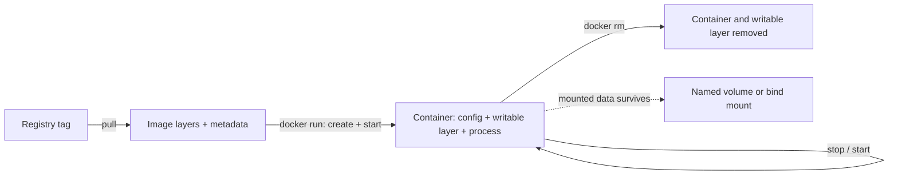

# 02 — Images and Containers

## Images

An image is an immutable template made from filesystem layers and metadata. Layers can be shared between images, reducing repeated storage and downloads. A **tag** such as `python:3.12-slim` is a human-readable reference that can be moved to another image; it is not inherently immutable. A digest (`image@sha256:...`) identifies exact content. Pin versions or digests when reproducibility matters, and update deliberately for security fixes.

Registries store images. `docker pull nginx:1.28.2` downloads an image; `docker image ls` lists local images. A missing tag commonly means Docker attempts to pull it during `run`.

## Containers and lifecycle

A container is a runnable instance of an image. It has a writable layer, a process, configuration, and possibly attached networks and mounts. Removing it removes its writable layer; data in a named volume or bind mount remains separately stored.



The image stays unchanged when a container writes files. A tag is a movable label, while a digest (for example `image@sha256:...`) identifies exact image content. Docker Hub is a registry; private registries can host images too.

```bash
docker run --name demo -d -p 8080:80 nginx:1.28.2
docker ps                 # running containers
docker ps -a              # running and stopped containers
docker logs -f demo       # follow stdout/stderr
docker inspect demo       # detailed configuration and state
docker exec -it demo sh   # start an additional process in a running container
```

`-d` runs detached; without it, the client remains attached to the foreground process. `-p 8080:80` publishes host port 8080 to container port 80. The named container is reachable in a browser at `http://localhost:8080` if that host port is available. Container ports are not automatically published to the host.

Lifecycle operations differ:

- `stop` asks the main process to stop gracefully, then kills it after a timeout if needed.
- `start` starts an existing stopped container; `restart` stops and starts it.
- `pause` freezes container processes; `unpause` resumes them.
- `rm` removes a stopped container. `rm -f` forcibly stops and removes it.

Stopping preserves the container and its writable layer. Removing the container deletes that layer, so files written only inside it are lost. Persist important data in volumes or bind mounts.

```bash
docker stop demo
docker start demo
docker restart demo
docker pause demo
docker unpause demo
docker stop demo
docker rm demo
docker image rm nginx:1.28.2 # removes the image only when no container depends on it
```

## References

[Containers](https://docs.docker.com/engine/containers/) · [Images](https://docs.docker.com/engine/storage/drivers/) · [Run](https://docs.docker.com/reference/cli/docker/container/run/)

**Data Engineering use:** run short-lived ingestion jobs from the same image with different input arguments or environment. A zero exit code means the process reported success, not that downstream data quality is correct.

**Interview check:** If a job container exits with code 0, is it still a container? Yes: it is stopped and can be inspected or removed. What should hold data that must outlive that container? A mounted volume or external storage, plus a backup plan when the data matters.
