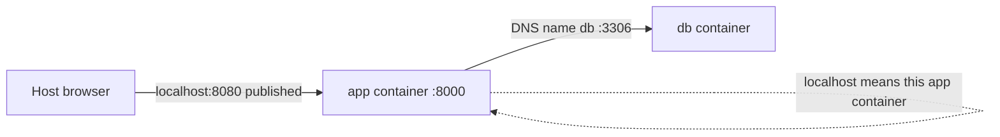

# 05 — Networking

Containers communicate through Docker networks. A bridge network connects containers on one Docker host. The default bridge has limitations; a user-defined bridge provides automatic DNS resolution by container name and better isolation.

```bash
docker network create app-net
docker run -d --name web --network app-net nginx:1.28.2
docker run --rm --network app-net busybox:1.36 wget -qO- http://web
docker network inspect app-net
docker network rm app-net
```

Publishing maps a host port to a container port: `-p 8080:80` means host 8080 → container 80. `EXPOSE 80` in a Dockerfile is metadata only and does not publish a port. Without `-p`, a service is generally reachable by peers on an attached network but not through a host port.

Inside a container, `localhost` means that same container. In Compose, the Python service should connect to the database using the service name (for example `db`) and its container port (`3306`), not `localhost` and not a host-published port. The host accesses a published app port through `localhost:<host-port>`.

Compose creates a project network and registers service names with internal DNS. Services on that network can resolve each other by service name. Networks also allow isolation: place only services that need to communicate together.



The host port is for traffic entering from outside the Compose network. Service-to-service traffic uses the internal container port; publishing `3306` is unnecessary if only the app uses MySQL.

## Connection diagnosis

1. Confirm both containers are running and inspect logs: `docker compose ps`, `docker compose logs db app`.
2. Confirm both services share a network: `docker network inspect <network>`.
3. Check hostname, internal port, credentials, and application configuration.
4. Check readiness, not just process existence; a listening database may still be initializing.
5. Test DNS and TCP connectivity from the application container with available tools.
6. For host access, verify `ports:` mapping and that the host port is free.

## References

[Networking overview](https://docs.docker.com/engine/network/) · [Bridge driver](https://docs.docker.com/engine/network/drivers/bridge/) · [Compose networking](https://docs.docker.com/compose/how-tos/networking/)

**Common mistakes:** using a container IP (it may change after recreation), using `localhost` as the database hostname from the app container, and confusing the app's published host port with the database's internal port.

**Interview check:** If the host can open a published web port but the web container cannot reach MySQL, why is publishing MySQL's port not the first fix? The app should use shared-network DNS (`db`) and container port `3306`; inspect shared network membership and readiness first.
