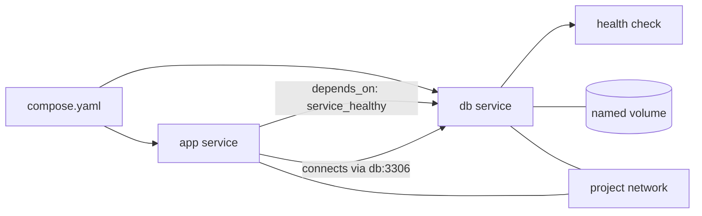

# 06 — Docker Compose

Docker Compose describes and operates a multi-container application using a `compose.yaml` file. It makes local services, networks, configuration, and storage repeatable. Compose is useful for development and testing; production orchestration needs depend on the system and is not solved universally by Compose.

Compose **services** describe containers. `image` selects an image; `build` builds from a Dockerfile. `ports` publishes ports; `environment` configures runtime variables; `networks` control connectivity; `volumes` attach persistent or host storage; `depends_on` controls startup ordering and can use health conditions. A Dockerfile describes how to build one image; Compose describes how related services run together.



Compose creates the project network and DNS entries. The health condition delays the dependent service until Docker reports the database healthy, while app retries handle later restarts or transient connection failures. Health checks are only as meaningful as the command they run.

```bash
docker compose up --build -d
docker compose ps
docker compose logs -f
docker compose exec app python -c "print('running')"
docker compose build
docker compose restart app
docker compose down                 # containers and network; named data volume remains
docker compose down --volumes       # also deletes project volumes and their data
```

The complete Python + MySQL example is in [Exercise 03](exercises/03-python-mysql/README.md). It uses a MySQL health check and application retries: `depends_on` alone only orders startup and does not mean a database is ready to accept connections.

An `.env` file is read by Compose for interpolation in the Compose model; values enter a service only because this example explicitly lists them under `environment:`. The `.env.example` is safe to copy as a starting point, but the local `.env` must remain ignored and uncommitted. MySQL initialization variables such as `MYSQL_DATABASE` and `MYSQL_USER` are applied when the data directory is first initialized. Reusing `mysql-data` keeps the already initialized database; changing those variables later does not recreate the database or reset its account password.

For routine operations: start with `up`, inspect with `ps`, follow logs, use `exec` for diagnosis, rebuild after source/image changes, and stop with `down`. Before any cleanup command that removes volumes, inspect the configured volume and confirm the data can be deleted.

## References

[Compose overview](https://docs.docker.com/compose/) · [Compose file reference](https://docs.docker.com/reference/compose-file/) · [Startup order](https://docs.docker.com/compose/how-tos/startup-order/) · [MySQL Official Image documentation](https://hub.docker.com/_/mysql)

**Interview check:** Explain why the database service can be reachable by `db:3306` without a host port mapping. Then explain why a fresh MySQL instance may take longer to become ready than a container takes to reach the `running` state.
